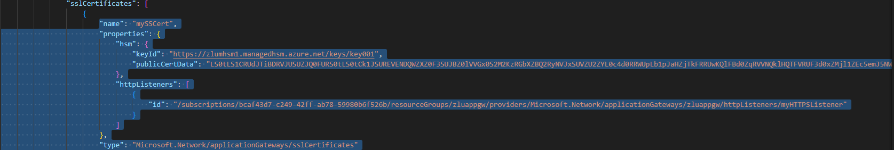
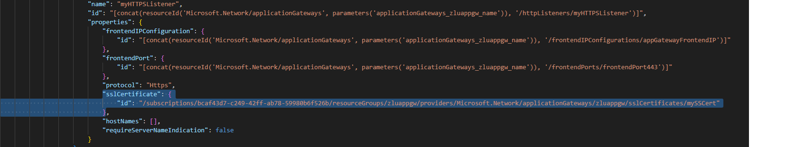
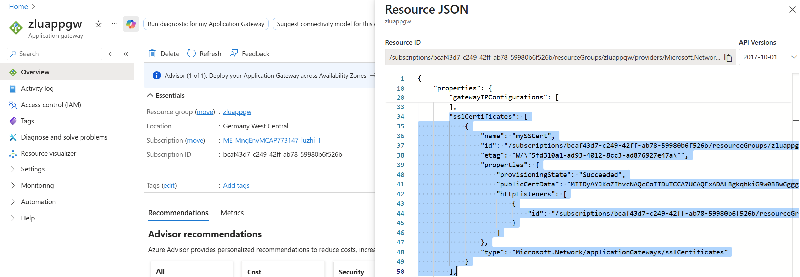
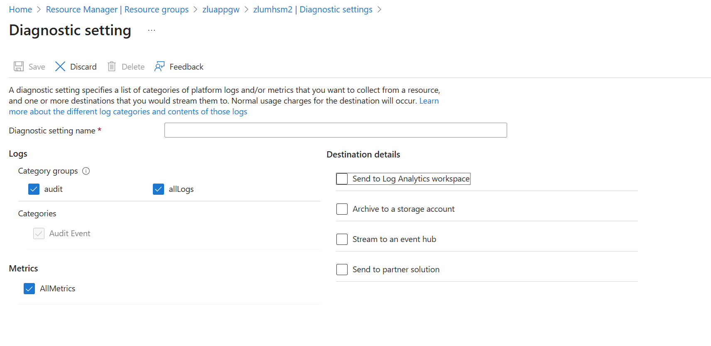
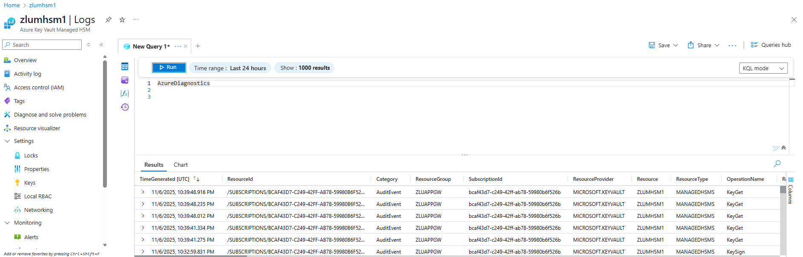

# Application Gateway and Managed HSM Keyless TLS Integration Lab

A comprehensive hands-on lab demonstrating keyless TLS integration between Azure Application Gateway and Azure Managed HSM. This lab provides step-by-step guidance for configuring secure TLS termination where private keys remain protected within FIPS 140-2 Level 3 hardware security modules and are never exposed or transmitted. The solution implements end-to-end encryption with keyless TLS on the client-side/edge and standard TLS re-encryption to backend servers.

## Overview

Keyless TLS is a security enhancement that allows TLS certificate private keys to remain within a Hardware Security Module (HSM) while still enabling TLS termination at the Application Gateway. This approach provides several benefits:

- **Enhanced Security**: Private keys never leave the HSM environment
- **FIPS 140-2 Level 3 Compliance**: Meets government-grade cryptographic security standards and regulatory requirements for sensitive key material protection
- **Centralized Key Management**: Single source of truth for cryptographic operations
- **Tamper-Resistant Hardware**: Physical security modules with tamper detection and automatic key zeroization capabilities
- **Dedicated High Performance**: Unlike Azure Key Vault's shared infrastructure, Managed HSM provides dedicated resources with higher throughput and no throttling limits for cryptographic operations

## Architecture

The solution integrates the following Azure services:

- **Azure Application Gateway**: Provides TLS termination and load balancing
- **Azure Managed HSM**: Stores private keys and performs cryptographic operations
- **Linux VM/Container**: Hosts OpenSSL and e_akv.so library for certificate operations and HSM integration

### High-Level Architecture Diagram


> **Note**: If the diagram above doesn't display properly, you can view the [text-based architecture overview](docs/architecture-overview.md).

The architecture demonstrates the flow of keyless TLS operations:

1. **TLS Handshake**: Client initiates secure connection with Application Gateway
2. **Identity Authentication**: Application Gateway authenticates with Azure Managed HSM using managed identity
3. **Cryptographic Operations**: Application Gateway performs crypto operations via HSM using PKCS#11 interface
4. **TLS Re-encryption**: Application Gateway re-encrypts and forwards traffic to backend servers using standard TLS

#### Key Architectural Components:

- **Azure Application Gateway**: Layer-7 load balancer with TLS termination capabilities and integrated TLS Offload Library (PKCS#11) for keyless TLS operations
- **Azure Managed HSM**: FIPS 140-2 Level 3 validated hardware security module for private key storage and cryptographic operations
- **Linux VM**: Virtual machine hosting certificate generation tools, OpenSSL, and e_akv.so library with PKCS#11 interface for HSM integration
- **Backend Servers**: Target applications including web applications, Azure Container Apps, and microservices that receive re-encrypted TLS traffic

## Prerequisites

Before starting this lab, ensure you have:

### Azure Lab Environment
- Azure subscription with owner role permissions
- Access to Azure portal and Cloud Shell

### Required Permissions
- **Managed HSM Crypto Officer** role for initial setup
- **Managed HSM Crypto User** role for key operations
- **RBAC Owner** role for granting access to other Azure resources

### Software Requirements
- Azure CLI or Azure PowerShell
- OpenSSL-3.0.13 for certificate operations
- Azure Managed HSM TLS Offload Library (e_akv.so)

## Lab Sections

### 1. Environment Variables Setup

#### 1.1 Azure CLI Authentication

First, open the Cloud Shell in Azure Portal, then authenticate with Azure CLI and select the subscription where you have owner role permissions:

```bash
# Login to Azure CLI (will prompt you to select subscription if you have multiple)
az login

# Verify the current subscription
az account show --output table
```

#### 1.2 Environment Variables

Set up the required environment variables for the lab. **Replace all placeholder values with your own values**:

```bash
# Access token for Azure Management API (keep this as-is)
export TOKEN=$(az account get-access-token --resource https://management.azure.com --query accessToken --output tsv)

# Azure subscription and resource group - REPLACE WITH YOUR VALUES
export SUBSCRIPTION_ID="<your-subscription-id>"
export RESOURCE_GROUP="<your-resource-group-name>"
export LOCATION="<your-preferred-location>"

# Application Gateway configuration - REPLACE WITH YOUR VALUES
export APPGW_NAME="<your-app-gateway-name>"
export VNET_NAME="<your-vnet-name>"
export ADDRESS_PREFIX="<your-address-prefix>"
export APPGW_SUBNET="<your-appgw-subnet-name>"
export APPGW_SUBNET_PREFIX="<your-appgw-subnet-prefix>"
export BACKEND_POOL="<your-backend-pool-name>"
export BACKEND_SUBNET="<your-backend-subnet-name>"
export BACKEND_SUBNET_PREFIX="<your-backend-subnet-prefix>"
export HTTPS_SETTING_NAME="<your-https-setting-name>"
export PROBE_NAME="<your-probe-name>"
export APPGW_PIP_NAME="<your-public-ip-name>"
export LISTENER="<your-https-listener-name>"
export HTTPS_PORT="<your-frontend-port-name>"
export MULTISITE_LISTENER_NAME="<your-multisite-listener-name>"
export MULTISITE_HOSTNAME="<your hostname for mutlisite> e.g. mysite1.com"

# Container Apps configuration - REPLACE WITH YOUR VALUES
export ACA_ENV="<your-container-apps-env-name>"
export ACA_NAME="<your-container-app-name>"

# Managed Identity and HSM configuration - REPLACE WITH YOUR VALUES
export MI_NAME="<your-managed-identity-name>"
export MHSM_NAME="<your-managed-hsm-name>"
export SECURITY_DOMAIN="<your-security-domain-file>"
export PRIVATE_KEY="<your-private-key-name>"

# Certificate configuration - REPLACE WITH YOUR VALUES
export SSCERT_PASSWD="<your-certificate-password>"
export SSCERT_NAME="<your-certificate-name>"
export SSCERT_FILE="<your-certificate-file>"
```

> **Important**: Replace all placeholder values (enclosed in `< >`) with your own values. Only the `TOKEN` variable should remain as-is since it dynamically retrieves the access token.

After setting up your environment variables, they should look similar to this example:


> **Note**: This screenshot shows an example configuration with actual values. Your actual values will be different based on your specific setup and naming preferences.

### 2. Provision and configure Managed HSM

Create the Azure resource group and provision a Managed HSM with security domain:

```bash
# Create resource group
az group create --name $RESOURCE_GROUP --location $LOCATION

# Get the current user's object ID for HSM administrator
export oid=$(az ad signed-in-user show --query id -o tsv)

# Create the Managed HSM with the current user as administrator
az keyvault create --hsm-name $MHSM_NAME --resource-group $RESOURCE_GROUP --location $LOCATION --administrators $oid --retention-days 7

# Generate three security domain certificates for HSM initialization
openssl req -newkey rsa:2048 -nodes -keyout cert_0.key -x509 -days 3650 -out cert_0.cer -subj "/C=US/ST=WA/L=Redmond/O=MyCompany/CN=myapp.example.com"
openssl req -newkey rsa:2048 -nodes -keyout cert_1.key -x509 -days 3650 -out cert_1.cer -subj "/C=US/ST=WA/L=Redmond/O=MyCompany/CN=myapp.example.com"
openssl req -newkey rsa:2048 -nodes -keyout cert_2.key -x509 -days 3650 -out cert_2.cer -subj "/C=US/ST=WA/L=Redmond/O=MyCompany/CN=myapp.example.com"

# Download and initialize the security domain for the HSM
az keyvault security-domain download --hsm-name $MHSM_NAME --sd-wrapping-keys ./cert_0.cer ./cert_1.cer ./cert_2.cer --sd-quorum 2 --security-domain-file $SECURITY_DOMAIN

# Archive all generated files for backup and portability
tar -czvf mhsm.tar.gz ./*
```

To download the archived files, go to Cloud Shell and select "Manage files" to download the `mhsm.tar.gz` file:


### 3. Create User Managed Identity and Assign RBAC Roles

Create a user-assigned managed identity that will be used for authentication with the Azure Managed HSM:

```bash
# Create user-assigned managed identity
az identity create --name $MI_NAME --resource-group $RESOURCE_GROUP --location $LOCATION

# Get the principal ID of the managed identity for role assignments
export mioid=$(az identity show --name $MI_NAME --resource-group $RESOURCE_GROUP --query principalId --output tsv)

# Assign "Managed HSM Crypto User" role to the managed identity for key operations (this will be used for Application Gateway)
az keyvault role assignment create --hsm-name $MHSM_NAME --role "Managed HSM Crypto User" --assignee-object-id $mioid --assignee-principal-type MSI --scope /keys

# Assign "Managed HSM Crypto User" role to the managed identity for key operations (this is for Cloud Shell)
az keyvault role assignment create --hsm-name $MHSM_NAME --role "Managed HSM Crypto User" --assignee-object-id $oid --assignee-principal-type MSI --scope /keys

# Verify Cloud Shell has access to the Managed HSM keys
az keyvault key list --hsm-name $MHSM_NAME
```

### 4. Create Managed HSM Private Key

Generate a private key in the Azure Managed HSM that will be used for keyless TLS operations:

```bash
# Create RSA private key in Managed HSM for TLS operations
az keyvault key create --hsm-name $MHSM_NAME --name $PRIVATE_KEY --ops wrapKey unwrapKey sign --kty RSA-HSM --size 2048 

# Verify the key has been created and list all keys in the HSM
az keyvault key list --hsm-name $MHSM_NAME
```

### 5. Provision Linux VM for Certificate Operations

Create an Ubuntu VM that will be used for certificate operations and TLS Offload Library configuration:

#### 5.1 Create Ubuntu VM
Follow the steps [here](https://learn.microsoft.com/en-us/azure/virtual-machines/linux/quick-create-portal?tabs=ubuntu) to create a new virtual machine based on Ubuntu Linux.

#### 5.2 Create a system managed identity

Follow the steps [here](https://learn.microsoft.com/en-us/entra/identity/managed-identities-azure-resources/how-to-configure-managed-identities?pivots=qs-configure-portal-linux-vm#enable-system-assigned-managed-identity-on-an-existing-vm) to enable a system managed identity on your Linux VM.

Once created, note the Object (principal) ID for a future step.

```bash
# Set the variable for the System Managed Identity Object ID
export smioid="<System Managed Identity Object ID>"

# Assign "Managed HSM Crypto User" role to the VM's system managed identity for Ubuntu VM's key operations
az keyvault role assignment create --hsm-name $MHSM_NAME --role "Managed HSM Crypto User" --assignee-object-id $smioid --assignee-principal-type MSI --scope /keys
```
### 6. Copy e_akv.so Library to the Ubuntu VM

Download and transfer the Azure Managed HSM TLS Offload Library to your Ubuntu VM:

#### 6.1 Download the TLS Offload Library

Download the [`e_akv.so`](libs/e_akv.so) library from the repository to your local machine:
- Click the link above to view the file, then click "Download" or "Raw" to save it locally
- Alternative: Right-click the link and select "Save link as..." to download directly

#### 6.2 Transfer the Library to Ubuntu VM

Transfer the `e_akv.so` library to your Ubuntu VM's home directory:
   
   **Option A: Using SCP (if connecting from Linux/macOS/Windows with WSL):**
   ```bash
   scp e_akv.so <username>@<vm-public-ip>:/home/<username>/
   ```
   
   **Option B: Using Azure portal file upload:**
   - Connect to your VM via SSH through the Azure portal
   - Use the file upload feature in the Azure portal SSH session
   - Upload the file to `/home/<username>/` directory

   **Option C: Using wget (direct download on VM):**
   ```bash
   # SSH into your Ubuntu VM first, then run:
   cd /home/<username>
   wget <library-download-url>
   ```
   > **Note**: Replace `<library-download-url>` with the official library download URL when available. For lab purposes, you can use the GitHub raw URL as an example: `https://github.com/luzhi_microsoft/appgw-mhsm-tls-integration-lab/raw/main/libs/e_akv.so`

Replace `<username>` with your actual Ubuntu username and `<vm-public-ip>` with your VM's public IP address.

### 7. Configuring Ubuntu VM with OpenSSL and TLS Offload Library

Configure the Ubuntu VM with the required dependencies, OpenSSL 3.0.13, and the TLS Offload Library:

#### 7.1 SSH to Ubuntu VM and Configure the Environment

SSH to your Ubuntu VM and navigate to the home directory where you transferred the `e_akv.so` library:

```bash
# SSH into your Ubuntu VM and navigate to the user directory
cd /home/<username>

# Set proper permissions for the TLS Offload Library
chmod 755 /home/azureuser/e_akv.so

# Update system packages
sudo apt update && sudo apt upgrade -y

# Install build dependencies
sudo apt install build-essential zlib1g-dev -y
```

#### 7.2 Install OpenSSL 3.0.13

Download, compile, and install OpenSSL 3.0.13:

```bash
# Navigate to source directory
cd /usr/local/src

# Download OpenSSL 3.0.13 source code
sudo wget https://www.openssl.org/source/openssl-3.0.13.tar.gz --no-check-certificate

# Extract the source code
sudo tar -xvzf openssl-3.0.13.tar.gz
cd openssl-3.0.13

# Configure OpenSSL build
sudo ./config --prefix=/opt/openssl-3.0.13 --openssldir=/opt/openssl-3.0.13 shared zlib

# Compile OpenSSL (using all available CPU cores)
sudo make -j$(nproc)

# Install OpenSSL
sudo make install

# Verify OpenSSL version
openssl version

# Expected output:
# OpenSSL 3.0.13 30 Jan 2024 (Library: OpenSSL 3.0.13 30 Jan 2024)
```

#### 7.3 Configure TLS Offload Library

Install and configure the Azure Managed HSM TLS Offload Library:

```bash
# Copy the engine binary to OpenSSL engine directory
sudo cp /home/azureuser/e_akv.so /opt/openssl-3.0.13/lib64/engines-3/

# Verify the hash of the e_akv.so file
md5sum /opt/openssl-3.0.13/lib64/engines-3/e_akv.so

# Expected output:
# de1f6553e5da8c3a6a3456c037fa7d1d  /opt/openssl-3.0.13/lib64/engines-3/e_akv.so
```

#### 7.4 Configure Environment Variables

Set up the required environment variables for OpenSSL and the TLS Offload Library:

```bash
# Configure environment variables for this session
export LD_LIBRARY_PATH=/opt/openssl-3.0.13/lib64:$LD_LIBRARY_PATH
export OPENSSL_ENGINES=/opt/openssl-3.0.13/lib64/engines-3
export PATH=/opt/openssl-3.0.13/bin:$PATH

# Test the e_akv.so engine is working properly
openssl engine -t -c -vvvv e_akv

# Expected output:
# (e_akv) AKV/HSM engine 
# [RSA, rsaEncryption, RSASSA-PSS, id-ecPublicKey] [ available ]

# Verify OpenSSL version
openssl version

# Expected output:
# OpenSSL 3.0.13 30 Jan 2024 (Library: OpenSSL 3.0.13 30 Jan 2024)
```

#### 7.5 Generate Self-Signed Certificate Using HSM Private Key

Create a self-signed certificate using the private key stored in Azure Managed HSM:

```bash
# Set certificate configuration
export OPENSSL_CERT_DAYS=3650
export OPENSSL_CERT_SUBJ=/CN=contoso.com

# Navigate to a directory where you have write access
cd /home/<username>

# Set the HSM and private key variables (replace with your actual values)
MHSM_NAME="<your-mhsm-name>"
PRIVATE_KEY="<your-private-key-name>"

# Generate self-signed certificate using HSM private key
openssl req -new -x509 -engine e_akv -keyform engine -key managedHsm:$MHSM_NAME:$PRIVATE_KEY -out cert_rsa.pem -subj $OPENSSL_CERT_SUBJ -days $OPENSSL_CERT_DAYS

# Convert the certificate to base64 format for Application Gateway
base64 -w0 cert_rsa.pem > base64.txt
```

> **Important**: 
> - Replace `<username>` with your actual Ubuntu username
> - Replace `<your-mhsm-name>` with your actual Managed HSM name
> - Replace `<your-private-key-name>` with your actual private key name
> - Ensure you're in a directory where you have write permissions when generating the certificate

The certificate (`cert_rsa.pem`) and its base64-encoded version (`base64.txt`) will be created in your current directory. The base64-encoded certificate can be used for configuring Application Gateway with keyless TLS.

### 8. Deploy Application Gateway and Static App for Testing (Optional)

> **Note**: This section is optional. If you already have an Application Gateway (V2 SKU) and web server configured, you can skip this part and proceed to configure keyless TLS on your existing infrastructure.

Deploy a test environment with Application Gateway V2 and a static web application to demonstrate keyless TLS integration:

#### 8.1 Create Virtual Network and Subnets

Set up the network infrastructure for Application Gateway and backend services:

```bash
# Create virtual network with Application Gateway subnet
az network vnet create --name $VNET_NAME --resource-group $RESOURCE_GROUP --location $LOCATION --address-prefix $ADDRESS_PREFIX --subnet-name $APPGW_SUBNET --subnet-prefix $APPGW_SUBNET_PREFIX

# Create backend subnet for services
az network vnet subnet create --name $BACKEND_SUBNET --resource-group $RESOURCE_GROUP --vnet-name $VNET_NAME --address-prefix $BACKEND_SUBNET_PREFIX
```

#### 8.2 Deploy Static Web Application

Create a Container Apps environment and deploy a test web application:

```bash
# Register Microsoft.App resource provider if not already done
# az provider register --namespace Microsoft.App --wait

# Create Container Apps environment
az containerapp env create --name $ACA_ENV --resource-group $RESOURCE_GROUP --location $LOCATION --logs-destination none

# Create static web container application
az containerapp create --name $ACA_NAME --resource-group $RESOURCE_GROUP --environment $ACA_ENV --image nginxdemos/hello --target-port 80 --ingress external

# Get the static app URL for backend configuration
ACA_URL=$(az containerapp show --name $ACA_NAME --resource-group $RESOURCE_GROUP --query properties.configuration.ingress.fqdn --output tsv)

echo "Container App URL: https://$ACA_URL"
```

#### 8.3 Create Application Gateway Infrastructure

Set up the Application Gateway with basic configuration:

```bash
# Create public IP for Application Gateway
az network public-ip create --resource-group $RESOURCE_GROUP --name $APPGW_PIP_NAME --sku Standard

# Create self-signed certificates for Application Gateway (temporary)
openssl req -x509 -newkey rsa:2048 -keyout mykey.key -out mycert.crt -days 365 -nodes -subj "/C=US/ST=WA/L=Redmond/O=MyCompany/CN=myapp.example.com"

openssl pkcs12 -export -out $SSCERT_FILE -inkey mykey.key -in mycert.crt -passout pass:$SSCERT_PASSWD

# Create Application Gateway (basic skeleton)
az network application-gateway create --name $APPGW_NAME --location $LOCATION --resource-group $RESOURCE_GROUP --sku Standard_v2 --capacity 2 --public-ip-address $APPGW_PIP_NAME --vnet-name $VNET_NAME --subnet $APPGW_SUBNET --priority 100
```

#### 8.4 Configure SSL Certificate and HTTPS Settings

Upload SSL certificate and configure HTTPS components:

```bash
# Upload SSL certificate
az network application-gateway ssl-cert create --resource-group $RESOURCE_GROUP --gateway-name $APPGW_NAME --name $SSCERT_NAME --cert-file $SSCERT_FILE --cert-password $SSCERT_PASSWD

# Create frontend port for HTTPS
az network application-gateway frontend-port create --resource-group $RESOURCE_GROUP --gateway-name $APPGW_NAME --name $HTTPS_PORT --port 443

# Create HTTPS listener
az network application-gateway http-listener create --resource-group $RESOURCE_GROUP --gateway-name $APPGW_NAME --name $LISTENER --frontend-ip "appGatewayFrontendIP" --frontend-port $HTTPS_PORT --ssl-cert $SSCERT_NAME
```

#### 8.5 Configure Backend Pool and Health Probes

Set up backend services and health monitoring:

```bash
# Create backend pool with Container App
az network application-gateway address-pool create --gateway-name $APPGW_NAME --resource-group $RESOURCE_GROUP --name $BACKEND_POOL --servers $ACA_URL

# Create HTTPS backend settings
az network application-gateway http-settings create --gateway-name $APPGW_NAME --resource-group $RESOURCE_GROUP --name $HTTPS_SETTING_NAME --port 443 --protocol Https --cookie-based-affinity Disabled --host-name-from-backend-pool true

# Create HTTPS health probe
az network application-gateway probe create --gateway-name $APPGW_NAME --resource-group $RESOURCE_GROUP --name $PROBE_NAME --protocol Https --path "/" --interval 30 --timeout 30 --host-name-from-http-settings true

# Update HTTPS settings to use the health probe
az network application-gateway http-settings update --gateway-name $APPGW_NAME --resource-group $RESOURCE_GROUP --name $HTTPS_SETTING_NAME --probe $PROBE_NAME --port 443 --protocol Https --host-name-from-backend-pool true
```

#### 8.6 Configure Routing Rules

Set up routing from frontend listener to backend pool:

```bash
# Get the default rule name
RULE_NAME=$(az network application-gateway rule list --gateway-name $APPGW_NAME --resource-group $RESOURCE_GROUP --query "[0].name" --output tsv)

# Update the rule to route HTTPS traffic to backend pool
az network application-gateway rule update --gateway-name $APPGW_NAME --resource-group $RESOURCE_GROUP --name $RULE_NAME --http-listener $LISTENER --http-settings $HTTPS_SETTING_NAME --address-pool $BACKEND_POOL --priority 100
```

#### 8.7 Test the Deployment

Verify that both the Container App and Application Gateway are working correctly:

```bash
# Get Application Gateway public IP
APPGW_PUBLIC_IP=$(az network public-ip show --resource-group $RESOURCE_GROUP --name $APPGW_PIP_NAME --query ipAddress --output tsv)

echo "=== Test URLs ==="
echo "Container App Direct Access: https://$ACA_URL"
echo "Application Gateway Frontend: https://$APPGW_PUBLIC_IP"
echo ""
echo "=== Testing Instructions ==="
echo "1. Test Container App: Open https://$ACA_URL in your browser"
echo "2. Test Application Gateway: Open https://$APPGW_PUBLIC_IP in your browser"
echo "3. You will receive SSL certificate warnings because the certificates are self-signed - this is expected"
echo "4. Accept the certificate warnings to verify the applications are working"
```

> **Important Testing Notes**:
> - **Container App**: Should display a simple "Hello World" page from the nginxdemos/hello container
> - **Application Gateway**: Should proxy to the same content through the Application Gateway
> - **SSL Warnings**: Both endpoints will show SSL certificate warnings because they use self-signed certificates - this is expected and safe for testing
> - **Next Steps**: After confirming both endpoints work, you can proceed to configure keyless TLS using the HSM private key generated in Lab 9

> **Tip**: If you experience timeout issues when testing the Application Gateway Frontend, your Azure environment may have a Network Security Group (NSG) blocking traffic from your local machine's IP address. To remediate this issue, you can create an NSG rule to allow inbound HTTPS traffic:
>
> ```bash
> # OPTIONAL: If Azure automatically created and associated a NSG to the AppGW VNet, use the following to open up the ports
> NSG_NAME=$(az network vnet subnet show --resource-group $RESOURCE_GROUP --vnet-name $VNET_NAME --name $APPGW_SUBNET --query networkSecurityGroup.id --output tsv | awk -F '/' '{print $NF}')
> 
> # Add an inbound rule to allow HTTPS traffic from any source (0.0.0.0/0)
> # Note: For production environments, restrict the source to specific IP ranges for better security
> az network nsg rule create --resource-group $RESOURCE_GROUP --nsg-name $NSG_NAME --name AllowHTTPSInbound --priority 100 --direction Inbound --access Allow --protocol Tcp --source-address-prefix 0.0.0.0/0 --source-port-range "*" --destination-address-prefix "*" --destination-port-range 443
> ```

> [!CAUTION]
> **Understanding Current TLS Configuration**
> 
> At this stage, the Application Gateway is **NOT** configured with keyless TLS. The `.pfx` certificate file created in section 8.3 contains both the public certificate and the private key. This means the private key is stored locally on the Application Gateway, which is the traditional TLS termination approach. 
>
> The following labs will guide you through converting this setup to keyless TLS, where the private key remains securely within the Azure Managed HSM and is never exposed or transmitted to the Application Gateway.

This test environment provides a foundation for implementing keyless TLS where the Application Gateway will use the private key stored in Azure Managed HSM instead of the local self-signed certificate.

### 9. Configure Keyless TLS on Application Gateway

Configure Application Gateway to use keyless TLS with the private key stored in Azure Managed HSM:

#### 9.1 Associate User Managed Identity to Application Gateway

Assign the user-assigned managed identity to Application Gateway to enable authentication with Azure Managed HSM:

```bash
# Get the resource ID of the managed identity
export identityId=$(az identity show --name $MI_NAME --resource-group $RESOURCE_GROUP --query id -o tsv)

# Update Application Gateway to use the user-assigned identity
az network application-gateway update --name $APPGW_NAME --resource-group $RESOURCE_GROUP --set identity='{"type":"UserAssigned","userAssignedIdentities":{"'"$identityId"'":{}}}'

# Verify the identity has been associated
az network application-gateway show --name $APPGW_NAME --resource-group $RESOURCE_GROUP --query identity
```

The output should show the user-assigned managed identity associated with your Application Gateway.

#### 9.2 Export Application Gateway ARM Template

Export the Application Gateway configuration template for keyless TLS configuration:

- Navigate to your Application Gateway in the Azure Portal
- Go to the **Automation** blade in the left menu
- Click on **Export template**
- Click **Download** to save the ARM template to your local machine


> **Note**: The exported template will be used to configure keyless TLS parameters. Save the template file to a location where you can easily access and modify it.

#### 9.3 Configure Keyless TLS in ARM Template

After downloading the ARM template, you'll need to modify it to enable keyless TLS:

- Extract the downloaded template ZIP file
- Open the `template.json` file in your preferred editor (preferrably Visual Studio Code)
- Locate the SSL certificate configuration section in the `sslCertificates` array
  - **Rename the SSL certificate**: Change the certificate name to a new value (e.g., append `-v2` or increment version number). The Azure Resource Manager REST API uses incremental updates and requires a name change to recognize and apply certificate modifications.
  - **Update certificate data**: Copy the base64-encoded public certificate data from the `base64.txt` file generated in Lab 7.5 and paste it into the `publicCertData` field. Configure the `sslCertificates` section with the following JSON structure:

```json
"sslCertificates": [
    {
        "name": "mySSCert",
        "properties": {
            "hsm": {
                "keyId": "https://<HSM NAME (in this example zlumhsm1)>.managedhsm.azure.net/keys/<key-name (in this example: key001)>",
                "publicCertData": "Q......................=="
            },
            "httpListeners": [
                {
                    "id": "/subscriptions/xxxxxxxx-xxxx-xxxx-xxxx-xxxxxxxxxxxx/resourceGroups/mhsm-appgw-rg/providers/Microsoft.Network/applicationGateways/mhsm-appgw/httpListeners/myHTTPSListener"
                },
                {
                    "id": "/subscriptions/xxxxxxxx-xxxx-xxxx-xxxx-xxxxxxxxxxxx/resourceGroups/mhsm-appgw-rg/providers/Microsoft.Network/applicationGateways/mhsm-appgw/httpListeners/https-mhsm-listener2"
                }
            ]
        },
        "type": "Microsoft.Network/applicationGateways/sslCertificates"
    }
],
```



- **Reference the certificate via your HTTPS listener**: Update the `httpListeners` section to reference the HSM-backed SSL certificate. Configure the listener using the following JSON structure:

```json
"httpListeners": [
    {
        "name": "myHTTPSListener",
        "properties": {
            "frontendIPConfiguration": {
                "id": "/subscriptions/xxxxxxxx-xxxx-xxxx-xxxx-xxxxxxxxxxxx/resourceGroups/mhsm-appgw-rg/providers/Microsoft.Network/applicationGateways/mhsm-appgw/frontendIPConfigurations/PublicIP-FE"
            },
            "frontendPort": {
                "id": "/subscriptions/xxxxxxxx-xxxx-xxxx-xxxx-xxxxxxxxxxxx/resourceGroups/mhsm-appgw-rg/providers/Microsoft.Network/applicationGateways/mhsm-appgw/frontendPorts/port_443"
            },
            "sslCertificate": {
                "id": "/subscriptions/xxxxxxxx-xxxx-xxxx-xxxx-xxxxxxxxxxxx/resourceGroups/mhsm-appgw-rg/providers/Microsoft.Network/applicationGateways/mhsm-appgw/sslCertificates/mySSCert"
            },
            "protocol": "Https",
            "hostNames": [],
            "requireServerNameIndication": false,
            "requestRoutingRules": [
                {
                    "id": "/subscriptions/xxxxxxxx-xxxx-xxxx-xxxx-xxxxxxxxxxxx/resourceGroups/mhsm-appgw-rg/providers/Microsoft.Network/applicationGateways/mhsm-appgw/requestRoutingRules/HTTPS-MHSM-Rule"
                }
            ]
        },
        "type": "Microsoft.Network/applicationGateways/httpListeners"
    }
],
```



> **Important**: Ensure the `sslCertificate.id` references the certificate name you configured in the `sslCertificates` section (e.g., `mHSM-Key001`). The listener configuration establishes the connection between your HTTPS endpoint and the HSM-backed certificate.

#### 9.4 Redeploy Application Gateway with Updated ARM Template

After modifying the ARM template to enable keyless TLS, redeploy the Application Gateway configuration:

- **Upload template files to Azure Cloud Shell**: Transfer the modified `template.json` and `parameters.json` files to Azure Cloud Shell using one of the following methods:
  - **Option A**: Open the files locally, copy their contents, create new files in Cloud Shell, and paste the content
  - **Option B**: Use Cloud Shell's **Manage files** feature (upload icon in the toolbar) to upload the files directly

- **Validate the template**: Before deploying, validate the JSON syntax and configuration to catch any errors introduced during modification:

```bash
# Validate the ARM template and parameters
az deployment group validate --resource-group $RESOURCE_GROUP --template-file ./template.json --parameters @./parameters.json --debug
```

Review the validation output carefully. If any errors or syntax issues are reported, return to your template files and fix them before proceeding.

- **Deploy the updated configuration**: Once validation succeeds and everything looks correct, deploy the updated Application Gateway configuration:

```bash
# Deploy the ARM template to update Application Gateway with keyless TLS
az deployment group create --resource-group $RESOURCE_GROUP --template-file ./template.json --parameters @./parameters.json
```

> **Note**: The deployment process may take several minutes to complete. Monitor the deployment progress in the Azure Portal or wait for the CLI command to finish. Once complete, your Application Gateway will be configured with keyless TLS using the private key stored in Azure Managed HSM.

- **Verify successful deployment**: After deployment completes, you can verify the keyless TLS configuration by viewing the Application Gateway JSON in the Azure Portal. The new SSL certificate name should appear in the configuration, confirming that the HSM-backed certificate has been successfully applied.



> **Tip**: To view the Application Gateway JSON configuration in the portal, navigate to your Application Gateway resource, go to the **JSON View** option (usually found in the Overview or Properties section), and look for the `sslCertificates` array to confirm your new certificate name appears.

> [!NOTE]
> **Keyless TLS Now Active!**
>
> Congratulations! Your Application Gateway is now configured with **keyless TLS**. Unlike the traditional setup in Lab 8 where the private key was stored locally in the `.pfx` file, the private key now resides securely within the Azure Managed HSM and never leaves the hardware security module. 
>
> The Application Gateway performs all TLS cryptographic operations by making secure API calls to the Managed HSM, where the private key executes signing operations (KeySign) without ever being exposed or transmitted. This provides enterprise-grade security while maintaining full TLS termination capabilities.

### 10. Enable Managed HSM Diagnostics and Monitor Keyless TLS Operations (Optional)

> **Note**: This section is optional but highly recommended for production environments. Enabling diagnostics allows you to monitor and audit all cryptographic operations performed by Application Gateway against your Managed HSM, providing visibility into keyless TLS activity and helping with compliance requirements.

Configure diagnostic logging for Azure Managed HSM to monitor and audit keyless TLS cryptographic operations:

#### 10.1 Enable Managed HSM Diagnostic Settings

Set up diagnostic logging to capture HSM operations in a Log Analytics workspace:

- Navigate to your **Managed HSM** resource in the Azure Portal
- In the left menu, under **Monitoring**, select **Diagnostic settings**
- Click **+ Add diagnostic setting** to create a new configuration
- Configure the diagnostic setting with the following parameters:
  - **Diagnostic setting name**: Enter a descriptive name (e.g., `mhsm-diagnostics`)
  - **Logs**: Select **AuditEvent** to capture all HSM cryptographic operations
  - **Destination details**: Check **Send to Log Analytics workspace**
  - **Subscription**: Select your Azure subscription
  - **Log Analytics workspace**: Choose an existing workspace or create a new one
- Click **Save** to apply the diagnostic settings



> **Important**: After enabling diagnostics, it may take 5-10 minutes for logs to start appearing in the Log Analytics workspace. The AuditEvent log category captures all cryptographic operations including key usage, authentication events, and access attempts.

#### 10.2 Generate Traffic to Application Gateway

Generate HTTPS traffic to your Application Gateway to trigger keyless TLS operations that will be logged in the Managed HSM:

```bash
# Get Application Gateway public IP
APPGW_PUBLIC_IP=$(az network public-ip show --resource-group $RESOURCE_GROUP --name $APPGW_PIP_NAME --query ipAddress --output tsv)

# Generate multiple HTTPS requests to trigger TLS handshakes
echo "Generating traffic to Application Gateway..."
for i in {1..10}; do
  curl -k https://$APPGW_PUBLIC_IP
  echo "Request $i completed"
  sleep 2
done

echo "Traffic generation completed. Wait 5-10 minutes for logs to appear in Log Analytics."
```

> **Note**: Each HTTPS request initiates a TLS handshake where Application Gateway uses the private key stored in Managed HSM to perform cryptographic signing operations. The `-k` flag bypasses certificate validation since we're using a self-signed certificate for testing.

#### 10.3 Query Managed HSM Logs for Keyless TLS Operations

After generating traffic and waiting for logs to propagate, query the Log Analytics workspace to view HSM operations:

- Navigate to your **Managed HSM** resource in the Azure Portal
- In the left menu, under **Monitoring**, select **Logs**
- Close the **Queries** dialog if it appears
- In the query editor, enter the following KQL (Kusto Query Language) query:

```kql
AzureDiagnostics
| where ResourceProvider == "MICROSOFT.KEYVAULT"
| where Category == "AuditEvent"
| where OperationName == "KeySign"
| project TimeGenerated, OperationName, CallerIPAddress, identity_claim_appid_g, properties_s
| order by TimeGenerated desc
```

- Click **Run** to execute the query
- Review the results showing **KeySign** operations performed by Application Gateway



> **Understanding KeySign Operations**: When Application Gateway performs keyless TLS termination, it uses the mHSM private key to execute **KeySign** operations during the TLS handshake process. Specifically:
>
> - **Why KeySign?**: During the TLS handshake, the server (Application Gateway) must digitally sign a message to prove it possesses the private key corresponding to the certificate's public key. This signature operation is performed using the HSM private key.
> - **Why Not WrapKey/UnwrapKey?**: WrapKey and UnwrapKey operations are used for key encryption/decryption scenarios (e.g., encrypting data encryption keys). In TLS handshakes, the server needs to **sign** data (not encrypt/decrypt keys), which is why you see KeySign operations.
> - **TLS Handshake Flow**: During the TLS handshake, the Application Gateway receives a challenge from the client, uses the mHSM to sign this challenge with the private key (KeySign operation), and sends the signature back to the client to complete authentication.

#### 10.4 Additional Monitoring and Analysis

Enhance your monitoring capabilities with additional queries and insights:

**Query all HSM operations in the last hour:**
```kql
AzureDiagnostics
| where ResourceProvider == "MICROSOFT.KEYVAULT"
| where TimeGenerated > ago(1h)
| summarize Count=count() by OperationName, ResultType
| order by Count desc
```

**Monitor failed authentication attempts:**
```kql
AzureDiagnostics
| where ResourceProvider == "MICROSOFT.KEYVAULT"
| where ResultType != "Success"
| project TimeGenerated, OperationName, ResultType, CallerIPAddress, properties_s
| order by TimeGenerated desc
```

**Track KeySign operations over time:**
```kql
AzureDiagnostics
| where ResourceProvider == "MICROSOFT.KEYVAULT"
| where OperationName == "KeySign"
| summarize Count=count() by bin(TimeGenerated, 5m)
| render timechart
```

> **Best Practices**:
> - **Set up alerts**: Configure Azure Monitor alerts for failed HSM operations or unusual access patterns
> - **Regular audits**: Review HSM logs regularly to ensure only authorized applications (Application Gateway) are performing cryptographic operations
> - **Retention policies**: Configure appropriate log retention periods based on your compliance requirements
> - **Performance monitoring**: Use the time-series queries to identify peak usage patterns and optimize your Application Gateway capacity

## Additional Resources

For more information about Azure Managed HSM and Application Gateway keyless TLS integration:

- [Azure Managed HSM Documentation](https://learn.microsoft.com/azure/key-vault/managed-hsm/)
- [Application Gateway TLS Overview](https://learn.microsoft.com/azure/application-gateway/ssl-overview)
- [Azure Managed HSM TLS Offload Library](https://learn.microsoft.com/azure/key-vault/managed-hsm/tls-offload-library)

## Summary

Congratulations! You have successfully completed the Azure Application Gateway and Managed HSM Keyless TLS Integration Lab. Throughout this lab, you have:

1. ✅ Provisioned and configured an Azure Managed HSM with security domain
2. ✅ Created managed identities and assigned appropriate RBAC roles
3. ✅ Generated RSA private keys within the HSM for cryptographic operations
4. ✅ Configured an Ubuntu VM with OpenSSL and the TLS Offload Library
5. ✅ Generated self-signed certificates using HSM-backed private keys
6. ✅ Deployed Application Gateway with keyless TLS configuration
7. ✅ Updated Application Gateway to use HSM-backed certificates via ARM templates
8. ✅ Enabled diagnostics and monitored keyless TLS operations in real-time

**Key Takeaways:**
- Private keys remain secure within FIPS 140-2 Level 3 hardware and are never exported
- Application Gateway performs TLS termination using cryptographic operations delegated to the HSM
- All HSM operations are logged and auditable for compliance requirements
- KeySign operations during TLS handshakes prove the server possesses the private key without exposing it

This implementation provides enterprise-grade security for TLS termination while maintaining the flexibility and scalability of Azure Application Gateway.
