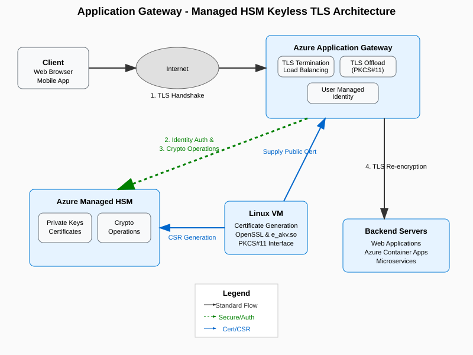
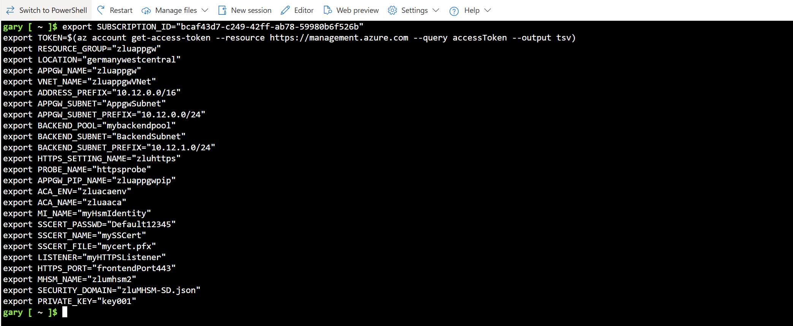
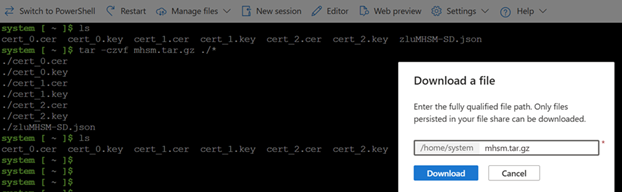

# Application Gateway and Managed HSM Keyless TLS Integration Lab

A comprehensive hands-on lab demonstrating keyless TLS integration between Azure Application Gateway and Azure Managed HSM. This lab provides step-by-step guidance for configuring secure TLS termination where private keys remain protected within FIPS 140-2 Level 3 hardware security modules and are never exposed or transmitted. The solution implements end-to-end encryption with keyless TLS on the client-side/edge and standard TLS re-encryption to backend servers.

## Overview

Keyless TLS is a security enhancement that allows TLS certificate private keys to remain within a Hardware Security Module (HSM) while still enabling TLS termination at the Application Gateway. This approach provides several benefits:

- **Enhanced Security**: Private keys never leave the HSM environment
- **FIPS 140-2 Level 3 Compliance**: Meets government-grade cryptographic security standards and regulatory requirements for sensitive key material protection
- **Centralized Key Management**: Single source of truth for cryptographic operations
- **Tamper-Resistant Hardware**: Physical security modules with tamper detection and automatic key zeroization capabilities
- **Dedicated High Performance**: Unlike Azure Key Vault's shared infrastructure, Managed HSM provides dedicated resources with higher throughput and no throttling limits for cryptographic operations

## Architecture

The solution integrates the following Azure services:

- **Azure Application Gateway**: Provides TLS termination and load balancing
- **Azure Managed HSM**: Stores private keys and performs cryptographic operations
- **Linux VM/Container**: Hosts OpenSSL and e_akv.so library for certificate operations and HSM integration

### High-Level Architecture Diagram



> **Note**: If the diagram above doesn't display properly, you can view the [text-based architecture overview](docs/architecture-overview.md).

The architecture demonstrates the flow of keyless TLS operations:

1. **TLS Handshake**: Client initiates secure connection with Application Gateway
2. **Identity Authentication**: Application Gateway authenticates with Azure Managed HSM using managed identity
3. **Cryptographic Operations**: Application Gateway performs crypto operations via HSM using PKCS#11 interface
4. **TLS Re-encryption**: Application Gateway re-encrypts and forwards traffic to backend servers using standard TLS

#### Key Architectural Components:

- **Azure Application Gateway**: Layer-7 load balancer with TLS termination capabilities and integrated TLS Offload Library (PKCS#11) for keyless TLS operations
- **Azure Managed HSM**: FIPS 140-2 Level 3 validated hardware security module for private key storage and cryptographic operations
- **Linux VM**: Virtual machine hosting certificate generation tools, OpenSSL, and e_akv.so library with PKCS#11 interface for HSM integration
- **Backend Servers**: Target applications including web applications, Azure Container Apps, and microservices that receive re-encrypted TLS traffic

## Prerequisites

Before starting this lab, ensure you have:

### Azure Lab Environment
- Azure subscription with owner role permissions
- Access to Azure portal and Cloud Shell

### Required Permissions
- **Managed HSM Crypto Officer** role for initial setup
- **Managed HSM Crypto User** role for key operations
- **RBAC Owner** role for granting access to other Azure resources

### Software Requirements
- Azure CLI or Azure PowerShell
- OpenSSL for certificate operations
- Azure Managed HSM TLS Offload Library (e_akv.so)

## Lab Sections

### 1. Environment Variables Setup

#### Azure CLI Authentication

First, open the Cloud Shell in Azure Portal, then authenticate with Azure CLI and select the subscription where you have owner role permissions:

```bash
# Login to Azure CLI (will prompt you to select subscription if you have multiple)
az login

# Verify the current subscription
az account show --output table
```

#### Environment Variables

Set up the required environment variables for the lab. **Replace all placeholder values with your own values**:

```bash
# Access token for Azure Management API (keep this as-is)
TOKEN=$(az account get-access-token --resource https://management.azure.com --query accessToken --output tsv)

# Azure subscription and resource group - REPLACE WITH YOUR VALUES
SUBSCRIPTION_ID="<your-subscription-id>"
RESOURCE_GROUP="<your-resource-group-name>"
LOCATION="<your-preferred-location>"

# Application Gateway configuration - REPLACE WITH YOUR VALUES
APPGW_NAME="<your-app-gateway-name>"
VNET_NAME="<your-vnet-name>"
ADDRESS_PREFIX="<your-address-prefix>"
APPGW_SUBNET="<your-appgw-subnet-name>"
APPGW_SUBNET_PREFIX="<your-appgw-subnet-prefix>"
BACKEND_POOL="<your-backend-pool-name>"
BACKEND_SUBNET="<your-backend-subnet-name>"
BACKEND_SUBNET_PREFIX="<your-backend-subnet-prefix>"
HTTPS_SETTING_NAME="<your-https-setting-name>"
PROBE_NAME="<your-probe-name>"
APPGW_PIP_NAME="<your-public-ip-name>"

# Container Apps configuration - REPLACE WITH YOUR VALUES
ACA_ENV="<your-container-apps-env-name>"
ACA_NAME="<your-container-app-name>"

# Managed Identity and HSM configuration - REPLACE WITH YOUR VALUES
MI_NAME="<your-managed-identity-name>"
MHSM_NAME="<your-managed-hsm-name>"
SECURITY_DOMAIN="<your-security-domain-file>"
PRIVATE_KEY="<your-private-key-name>"

# Certificate configuration - REPLACE WITH YOUR VALUES
SSCERT_PASSWD="<your-certificate-password>"
SSCERT_NAME="<your-certificate-name>"
SSCERT_FILE="<your-certificate-file>"
LISTENER="<your-https-listener-name>"
HTTPS_PORT="<your-frontend-port-name>"

echo "Environment variables set successfully!"
echo "Resource Group: $RESOURCE_GROUP"
echo "Location: $LOCATION"
echo "Managed HSM: $MHSM_NAME"
echo "Application Gateway: $APPGW_NAME"
```

> **Important**: Replace all placeholder values (enclosed in `< >`) with your own values. Only the `TOKEN` variable should remain as-is since it dynamically retrieves the access token.

#### Example: Configured Environment Variables

After setting up your environment variables, they should look similar to this example:



> **Note**: This screenshot shows an example configuration with actual values. Your actual values will be different based on your specific setup and naming preferences.

### 2. Provision and configure Managed HSM

Create the Azure resource group and provision a Managed HSM with security domain:

```bash
# Create resource group
az group create --name $RESOURCE_GROUP --location $LOCATION

# Get the current user's object ID for HSM administrator
oid=$(az ad signed-in-user show --query id -o tsv)

# Create the Managed HSM with the current user as administrator
az keyvault create --hsm-name $MHSM_NAME --resource-group $RESOURCE_GROUP --location $LOCATION --administrators $oid --retention-days 7

# Generate three security domain certificates for HSM initialization
openssl req -newkey rsa:2048 -nodes -keyout cert_0.key -x509 -days 3650 -out cert_0.cer -subj "/C=US/ST=WA/L=Redmond/O=MyCompany/CN=myapp.example.com"
openssl req -newkey rsa:2048 -nodes -keyout cert_1.key -x509 -days 3650 -out cert_1.cer -subj "/C=US/ST=WA/L=Redmond/O=MyCompany/CN=myapp.example.com"
openssl req -newkey rsa:2048 -nodes -keyout cert_2.key -x509 -days 3650 -out cert_2.cer -subj "/C=US/ST=WA/L=Redmond/O=MyCompany/CN=myapp.example.com"

# Download and initialize the security domain for the HSM
az keyvault security-domain download --hsm-name $MHSM_NAME --sd-wrapping-keys ./cert_0.cer ./cert_1.cer ./cert_2.cer --sd-quorum 2 --security-domain-file $SECURITY_DOMAIN

# Archive all generated files for backup and portability
tar -czvf mhsm.tar.gz ./*
```

To download the archived files, go to Cloud Shell and select "Manage files" to download the `mhsm.tar.gz` file:



### 3. Key Management
- [Generate TLS Keys in Managed HSM](docs/04-generate-tls-keys.md)
- [Configure Key Labels and Access](docs/05-configure-key-access.md)

### 4. Application Gateway Configuration
- [Deploy Application Gateway](docs/06-deploy-application-gateway.md)
- [Configure TLS Offload Library](docs/07-configure-tls-offload.md)
- [Set up Keyless TLS](docs/08-setup-keyless-tls.md)

### 5. Testing and Validation
- [Test TLS Handshake](docs/09-test-tls-handshake.md)
- [Validate Security Configuration](docs/10-validate-security.md)
- [Performance Testing](docs/11-performance-testing.md)

### 5. Troubleshooting
- [Common Issues and Solutions](docs/12-troubleshooting.md)

## Key Benefits

### Security Advantages
- **Private Key Protection**: Keys never leave the HSM boundary
- **Hardware Security**: FIPS 140-2 Level 3 validated security
- **Audit Trail**: Complete logging of cryptographic operations
- **Access Controls**: Granular role-based access to keys

### Operational Benefits
- **Centralized Management**: Single point for key lifecycle management
- **High Availability**: Built-in redundancy and failover
- **Scalability**: Supports high-throughput cryptographic operations
- **Compliance**: Meets regulatory requirements for key protection

## Implementation Approaches

### Simple Approach (Recommended for Testing)
1. Create service principal for TLS Offload Library
2. Assign "Managed HSM Crypto User" role at `/keys` scope
3. Generate keys with required labels
4. Configure Application Gateway with TLS Offload Library
5. Set up key labels and service principal credentials

### Granular Approach (Production Recommended)
1. Create separate admin user with "Managed HSM Crypto Officer" role
2. Create dedicated service principals for key generation and TLS operations
3. Create custom role definitions for fine-grained access
4. Implement per-key access controls
5. Configure monitoring and alerting

## Configuration Files

### TLS Offload Library Configuration
```json
{
    "ConnectionCache": {
        "Disable": false,
        "MaxConnections": 20
    },
    "ManagedHsm": {
        "VaultUri": "https://your-hsm.managedhsm.azure.net/",
        "ClientId": "your-client-id",
        "ClientSecret": "your-client-secret"
    }
}
```

### Application Gateway SSL Configuration
Key configuration elements for enabling keyless TLS:
- PKCS#11 library path configuration
- Key label references
- Service principal authentication
- Connection caching settings

## Security Considerations

### Access Control
- Use principle of least privilege
- Implement custom role definitions
- Enable per-key access controls
- Regular access reviews

### Monitoring and Auditing
- Enable diagnostic logging
- Monitor HSM operations
- Set up security alerts
- Regular security assessments

### Network Security
- Use private endpoints where possible
- Implement network segmentation
- Configure appropriate firewall rules
- Enable Azure DDoS protection

## Performance Optimization

### Connection Caching
- Configure appropriate MaxConnections limit
- Match concurrent signing requests
- Monitor connection pool utilization
- Optimize for your workload pattern

### Key Management
- Use appropriate key sizes
- Implement key rotation policies
- Monitor key usage patterns
- Plan for capacity requirements

## Troubleshooting Guide

### Common Issues
- **Authentication Errors**: Verify service principal credentials
- **Key Not Found**: Check key labels and access permissions
- **Connection Timeouts**: Review network configuration and firewall rules
- **Performance Issues**: Optimize connection cache settings

### Diagnostic Tools
- Azure Monitor logs
- Application Gateway diagnostics
- Managed HSM audit logs
- PKCS#11 library debugging

## Resources and References

### Official Documentation
- [Azure Managed HSM TLS Offload Library](https://learn.microsoft.com/azure/key-vault/managed-hsm/tls-offload-library)
- [Application Gateway TLS Configuration](https://learn.microsoft.com/azure/application-gateway/ssl-overview)
- [PKCS#11 Standard](https://docs.oasis-open.org/pkcs11/pkcs11-base/v2.40/pkcs11-base-v2.40.html)

### Sample Code and Scripts
- [TLS Offload Library Examples](https://github.com/microsoft/AzureManagedHsmTLSOffload)
- [Azure CLI Scripts](scripts/)
- [PowerShell Modules](scripts/powershell/)

## Contributing

We welcome contributions to improve this lab! Please see [CONTRIBUTING.md](CONTRIBUTING.md) for guidelines.

## License

This project is licensed under the MIT License - see the [LICENSE](LICENSE) file for details.

## Support

For questions and support:
- Create an issue in this repository
- Check the [troubleshooting guide](docs/12-troubleshooting.md)
- Review Azure documentation links above
A hands-on lab demonstrating the integration process for Keyless TLS with Application Gateway and Managed HSM.
